# Peatland Fire Susceptibility, Drivers, and Smoke Exposure under the 2023 to 2025 El Nino

A reproducible geospatial analysis of why Indonesian peatlands burned during the 2023 El Nino, which conditions drive that fire, and where the smoke travels. Built entirely from open data across five high risk districts in Sumatra and Kalimantan.

## What this project is

This is a screening and attribution study, not an operational fire spread forecaster. It answers four questions: which environmental conditions most strongly explain peatland fire, where the emerging fire hotspots are across 2023 to 2025, whether the El Nino peak genuinely raised fire risk, and in which direction the smoke travels on the worst days. All data are open access and the pipeline runs locally from a single command.

## Headline results

| Result | Value |
|---|---|
| Strongest fire driver | NDWI, vegetation dryness |
| Strongest driver interaction | VPD and Soil Moisture, strength 0.087 |
| El Nino linkage, fire count vs ONI | Pearson r = 0.684, p = 0.0018 |
| Temporal validation AUC | 0.62 in 2023, 0.74 in 2024, 0.66 in 2025 |
| Spatial cross validation AUC, mean | 0.708 |
| Highest risk district | Ogan Komering Ilir, mean susceptibility 0.16 |
| Fire detections by year | 690 in 2023, 265 in 2024, 148 in 2025 |
| Estimated CO2 emissions | 70 to 154 million tonnes, indicative range |

## Study area

Five peat dominated districts selected for fire history and contrast across two peat macro regions: Ogan Komering Ilir and Banyuasin in South Sumatra, Pulang Pisau and Kotawaringin Timur in Central Kalimantan, and Pelalawan in Riau.

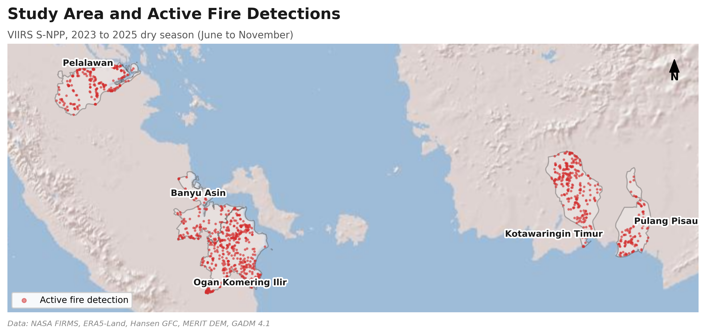

This map shows every VIIRS active fire detection across the 2023 to 2025 dry seasons. Fire concentrates heavily in the South Sumatra and Central Kalimantan peatlands, with Ogan Komering Ilir and Pulang Pisau carrying the densest clusters.

## Where peat is most prone to burn

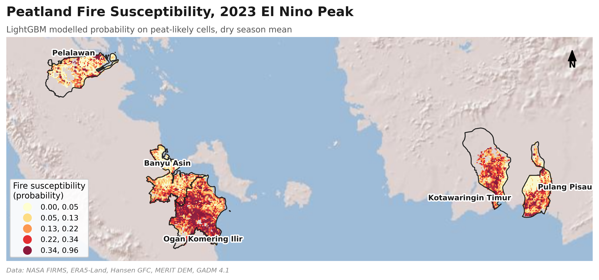

Modelled fire probability on peat likely cells at the 2023 El Nino peak. Darker red marks higher risk. Ogan Komering Ilir, with a mean susceptibility of 0.16, is the highest risk district, followed by Kotawaringin Timur at 0.11.

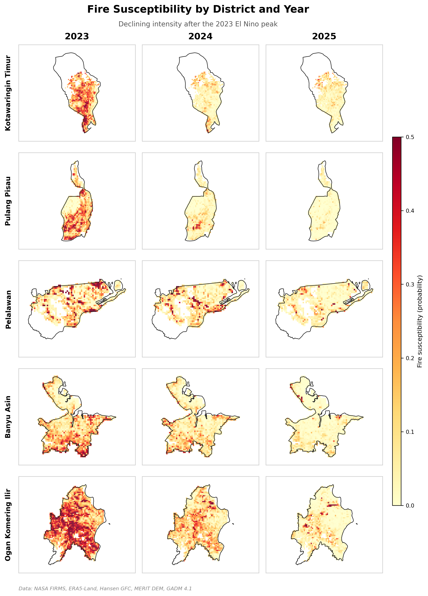

Districts are arranged as rows and years as columns. Mean susceptibility on peat cells falls from 0.20 in 2023 to 0.10 in 2024 and 0.05 in 2025, visible here as fading intensity from left to right. This is the clearest visual evidence of the El Nino effect.

## Emerging hotspots and where to act

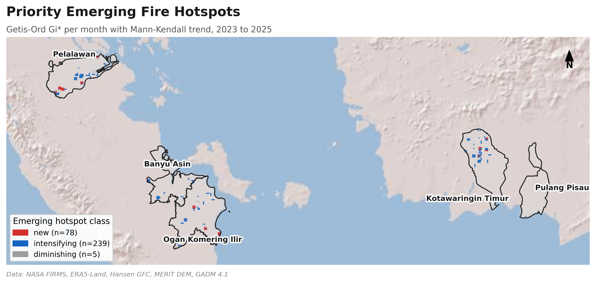

Getis-Ord Gi star clustering combined with a Mann-Kendall trend test classifies each cell. The analysis flags 239 intensifying cells, shown in blue, where fire activity is trending upward, and 78 new cells, shown in red, that became active in the later period. These are the locations that warrant priority monitoring.

## How smoke travels

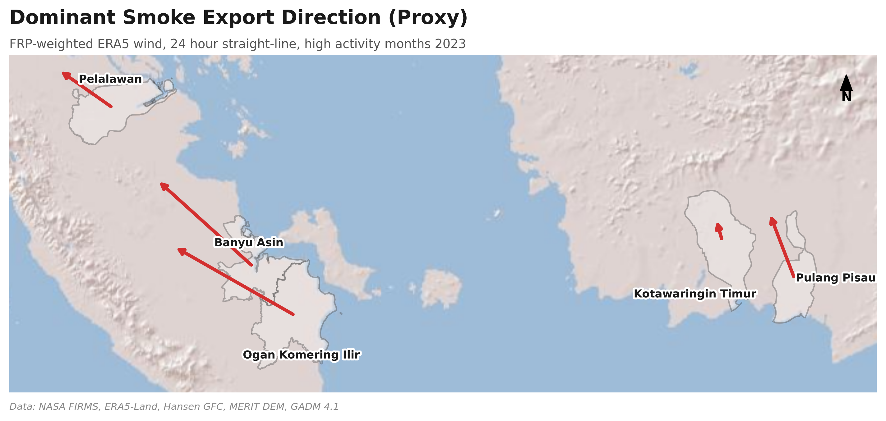

On high fire activity days, fire radiative power weighted winds carry smoke toward the northwest and the Malacca Strait corridor, the transboundary haze direction that affects neighbouring countries. The arrows indicate dominant export bearing per district. This is a wind based proxy for direction, not a full atmospheric dispersion model.

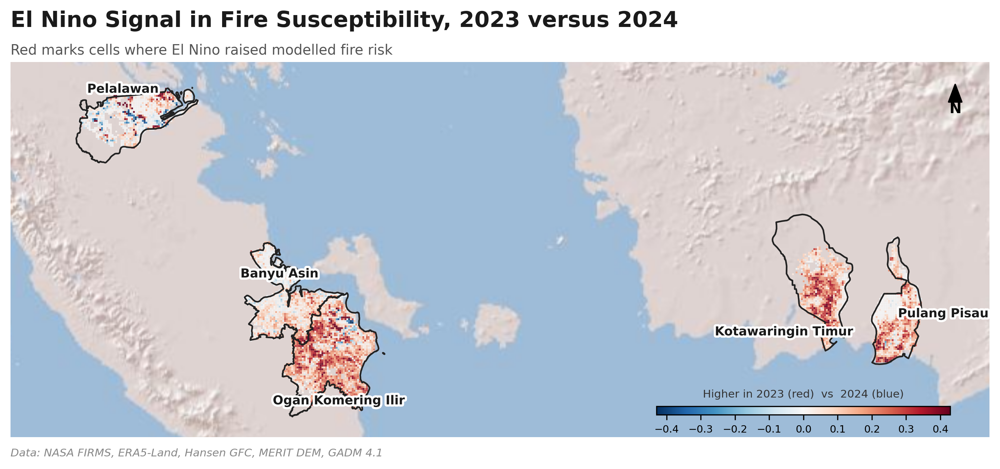

This map isolates the El Nino signal by subtracting 2024 susceptibility from 2023. Red cells are where the 2023 El Nino raised modelled fire risk relative to the following year, concentrated in the South Sumatra and Central Kalimantan peat cores.

## What drives the fire

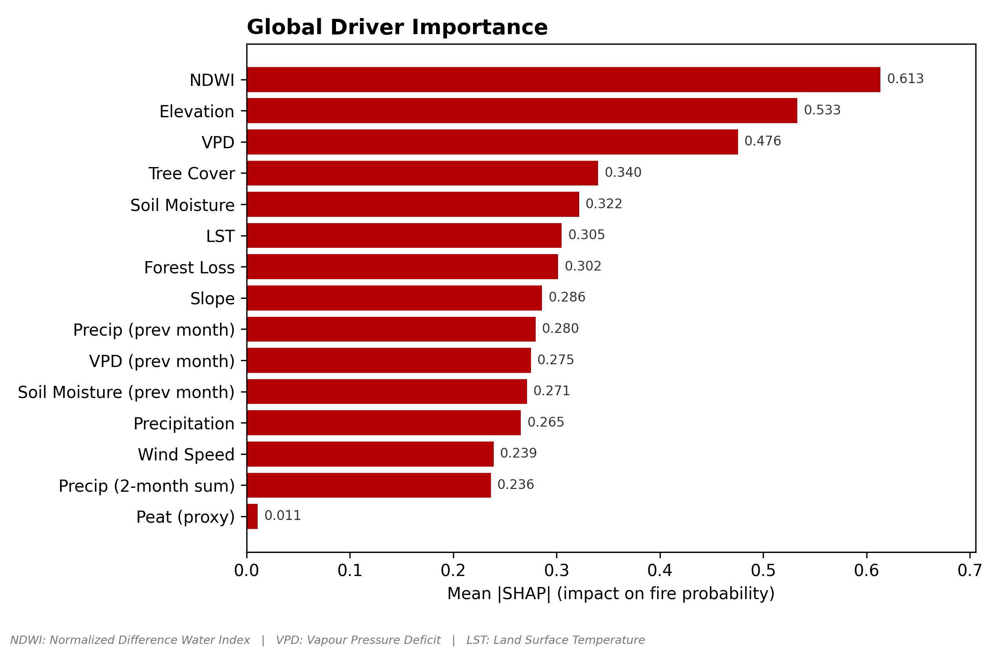

SHAP analysis ranks the predictors by their average impact on fire probability. NDWI, elevation, VPD, tree cover, and soil moisture lead. The key message is that dynamic dryness indicators, which change month to month, outrank static landscape attributes.

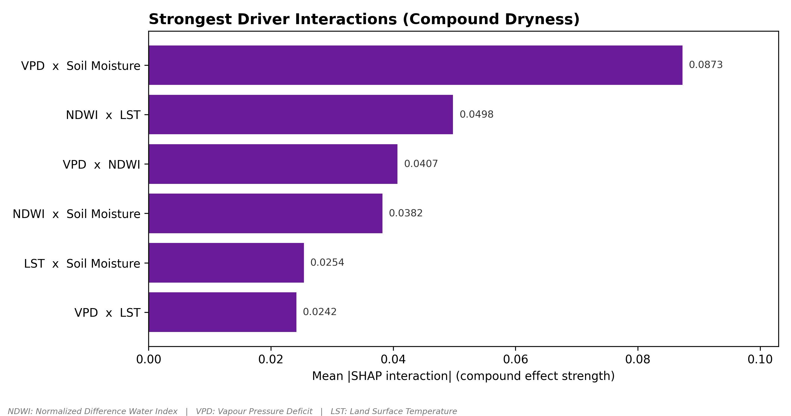

This chart shows how pairs of drivers act together. The interaction between VPD and soil moisture is the strongest at 0.087, nearly double the next pair. When dry air meets dry soil, fire risk escalates beyond what either factor alone would suggest.

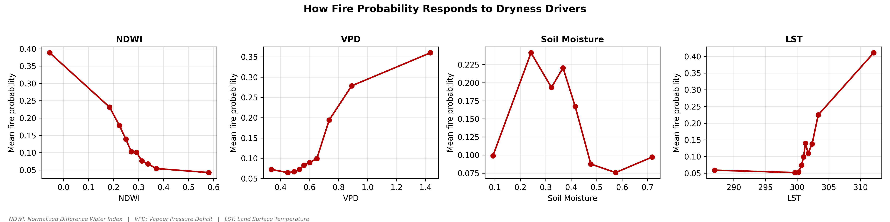

These curves show how fire probability responds as each dryness driver changes. For VPD, probability holds near 0.07 up to about 0.65 kPa, then climbs steeply, reaching roughly 0.36 at the highest values. This confirms a nonlinear dryness response rather than a gradual one.

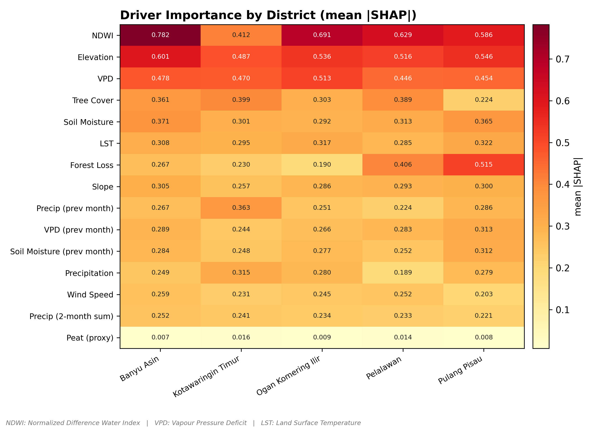

This heatmap breaks driver importance down by district, with the SHAP value printed in each cell. NDWI is the leading driver in four of the five districts, while Kotawaringin Timur is instead led by elevation, an early sign that drivers are not identical everywhere.

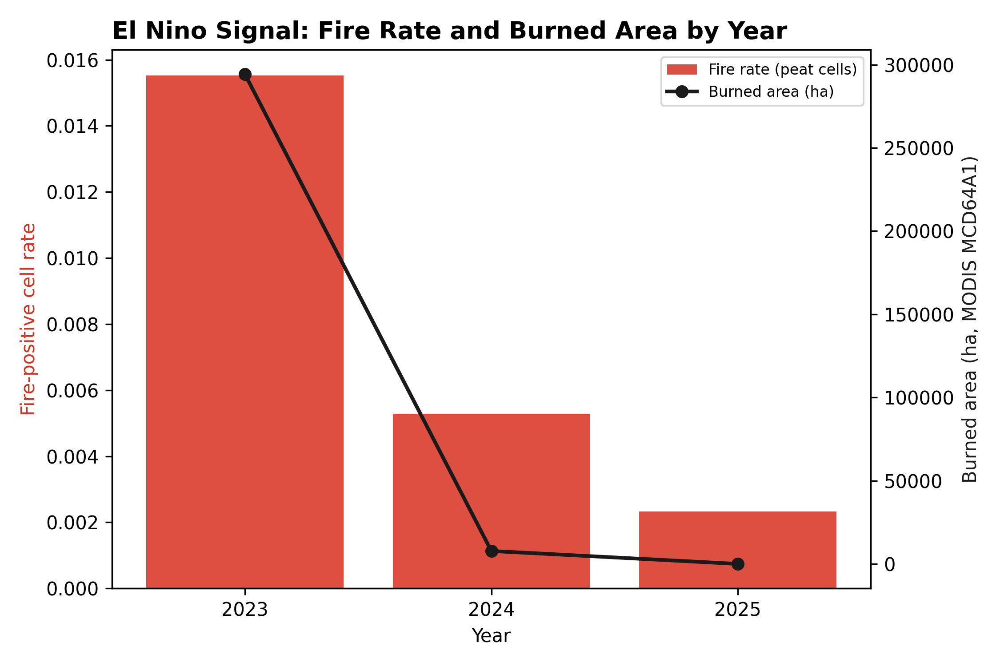

This chart pairs the modelled fire rate on peat cells, shown as bars, with the MODIS burned area, shown as the line, across the three study years. The fire rate falls from 0.016 in 2023 to 0.005 in 2024 and 0.002 in 2025, quantifying how far the El Nino peak exceeded later years.

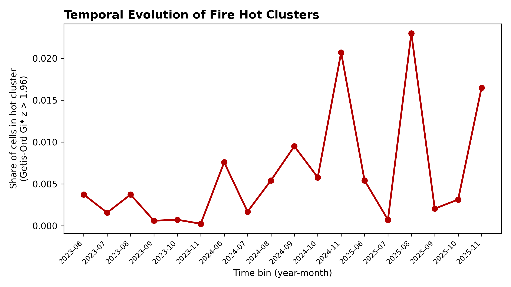

This time series tracks the share of cells classified as significant hot clusters in each monthly bin. The 2023 dry season months stand far above 2024 and 2025, showing when fire clustering was most intense.

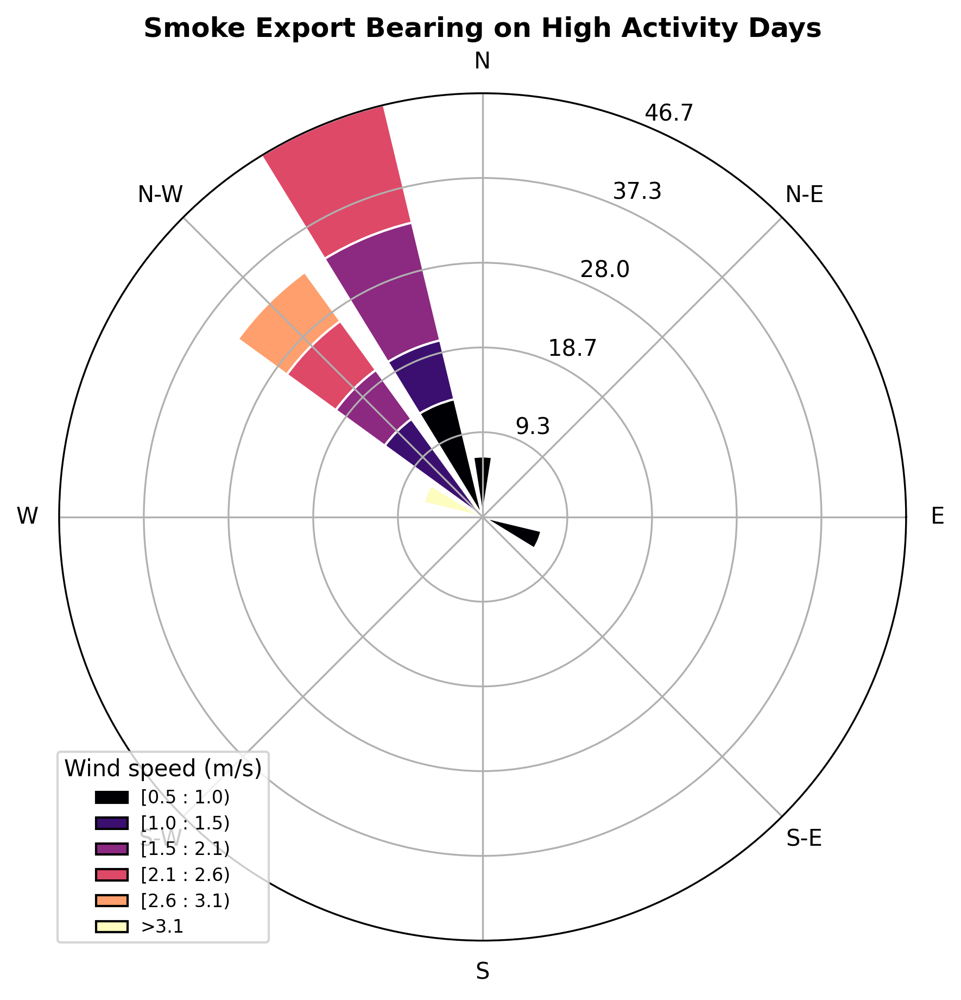

This windrose summarises smoke export bearings across all high activity district months. The dominant northwest orientation confirms the transboundary haze pathway seen in the smoke export map.

## Carbon emission context

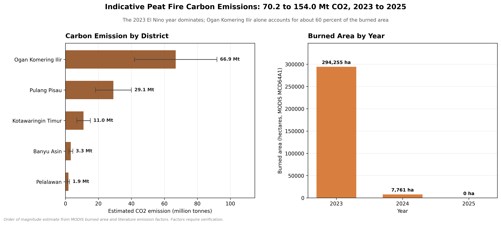

Peat fires release carbon that took centuries to accumulate. Using MODIS burned area and literature emission factors, we estimate total emissions of 70 to 154 million tonnes of CO2 across the five districts over 2023 to 2025. The 2023 El Nino year accounts for almost all of it, with 294,255 hectares burned compared with 7,761 hectares in 2024. Ogan Komering Ilir alone contributes about 60 percent of the burned area. This is an order of magnitude estimate; the underlying emission factors require verification before being cited as precise figures.

## Data sources

All open access, processed through Google Earth Engine and downloaded locally with metadata.

1. NASA FIRMS VIIRS active fire and FRP
2. ERA5 Land daily reanalysis for temperature, dewpoint, precipitation, and wind
3. MODIS MOD09A1 and MOD11A2 for NDWI and land surface temperature
4. NASA SMAP for surface soil moisture
5. Hansen Global Forest Change for tree cover and forest loss
6. MERIT DEM for elevation and slope
7. MODIS MCD64A1 for burned area context
8. GADM 4.1 for administrative boundaries

## Methodology in brief

A 3 km analysis grid was clipped to the five districts. A monthly feature table of climate, dryness, fuel, terrain, and fire labels was assembled, totalling 143,478 cell months with 1,107 fire positive cases. A LightGBM susceptibility model was trained with temporal hold out and leave one district out spatial cross validation. Drivers were attributed with TreeSHAP including interactions and partial dependence. Emerging hotspots were detected with Getis-Ord Gi star and a Mann-Kendall trend. Fire counts were linked to the Oceanic Nino Index. Full detail is in docs/methodology.md.

## How to run

Requires Python 3.11 on Windows. A Google Earth Engine service account key is needed for data fetching.

    cd /d E:\Project\peatfire-nino-2023-2024
    py -3.11 -m venv .venv
    .venv\Scripts\activate.bat
    python -m pip install --upgrade pip
    pip install -r requirements.txt
    pip install -e .
    copy credentials\credentials.env.example credentials\credentials.env
    python run_pipeline.py --skip-preflight --continue-on-error

Outputs appear in outputs/figures, outputs/tables, outputs/insights, and docs.

## Limitations

1. Peat extent is an elevation based proxy, not the licensed national peat map. The model ranks this proxy last, and residual spatial autocorrelation, Moran's I = 0.545, confirms a missing peat depth or water table layer.
2. Model skill is moderate, temporal AUC 0.62 to 0.74 and spatial mean 0.708. This is a screening tool, not a precise forecaster.
3. Smoke export is a wind based proxy, not a physical dispersion model.
4. The carbon estimate and the Oceanic Nino Index values require verification before publication.
5. Pelalawan is nearly unpredictable from climate alone, spatial AUC 0.51, suggesting human driven ignition that this climate based model cannot capture.

## Documentation

Detailed reports are available in the docs folder: conclusions, executive_summary, recommendations, how_to_read, and methodology.

## License

MIT. See LICENSE.
